# Интерактивная карта РФ

Конструктор тематических карт России для уроков географии, классных часов, конференций и отчётов. Карта показывает все 89 субъектов Российской Федерации. Регионы можно раскрасить по числам или по группам, обвести границы федеральных округов и других делений, поставить метки городов и скачать готовую картинку.

Программа — один файл `Интерактивная карта РФ.html`. Она открывается в браузере двойным щелчком, работает без интернета и ничего не требует устанавливать.

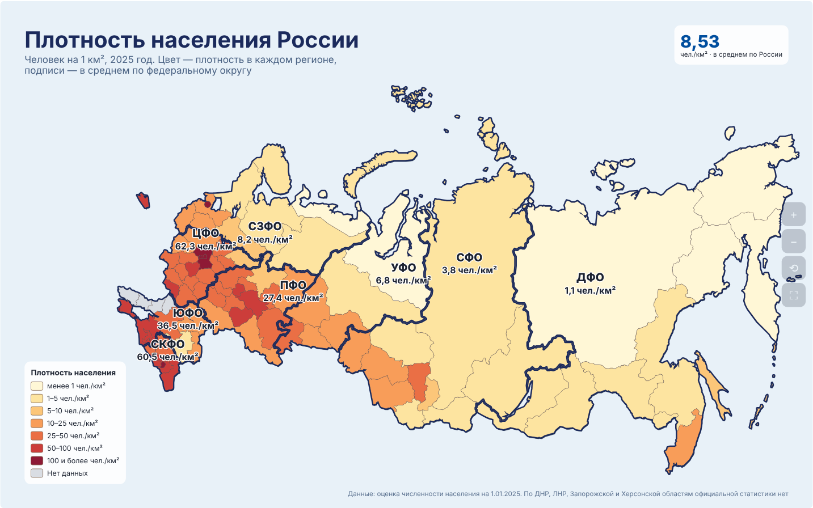

## Содержание

1. [Что умеет карта](#1-что-умеет-карта)
2. [Как открыть](#2-как-открыть)
3. [Экран программы](#3-экран-программы)
4. [Готовые карты и пример](#4-готовые-карты-и-пример)
5. [Режим «Числа»](#5-режим-числа)
6. [Режим «Группы» и кисть](#6-режим-группы-и-кисть)
7. [Загрузка и выгрузка Excel](#7-загрузка-и-выгрузка-excel)
8. [Закраска регионов](#8-закраска-регионов)
9. [Границы делений поверх карты](#9-границы-делений-поверх-карты)
10. [Подписи на регионах](#10-подписи-на-регионах)
11. [Метки](#11-метки)
12. [Легенда и итоги](#12-легенда-и-итоги)
13. [Оформление](#13-оформление)
14. [Тексты](#14-тексты)
15. [Показ на экране и горячие клавиши](#15-показ-на-экране-и-горячие-клавиши)
16. [Сохранение и передача](#16-сохранение-и-передача)
17. [Готовые сценарии для урока](#17-готовые-сценарии-для-урока)
18. [Частые вопросы и проблемы](#18-частые-вопросы-и-проблемы)
19. [Справочные данные и источники](#19-справочные-данные-и-источники)
20. [Для разработчиков](#20-для-разработчиков)

---

## 1. Что умеет карта

| Возможность | Что это значит |
| --- | --- |
| Все 89 субъектов РФ | Включая Республику Крым, Севастополь, ДНР, ЛНР, Запорожскую и Херсонскую области |
| Готовые деления | Федеральные округа, административно-территориальные единицы, военные округа, часовые пояса, экономические районы |
| Свои данные | Числа по регионам (население, школы, участники, баллы) или группы регионов («посетили», «нефть и газ») |
| Excel | Шаблон для заполнения, загрузка заполненной таблицы, выгрузка текущей карты |
| Границы поверх карты | Например, плотность населения по регионам и жирные границы федеральных округов |
| Метки | Города, месторождения, заповедники — булавка, кружок, звезда, квадрат или флажок |
| Подсказки | При наведении на регион — его значение, описание и справка: федеральный округ, военный округ, экономический район, часовой пояс |
| Оформление | Готовые темы, цвета, фон (в том числе триколор), шрифты, подписи, легенда |
| Показ и экспорт | Полный экран для проектора, картинка PNG или SVG, сохранение проекта в файл |

---

## 2. Как открыть

1. Дважды щёлкните по файлу **«Интерактивная карта РФ.html»**. Он откроется в браузере, как обычная веб-страница.
2. Если файл открылся в «Блокноте» или другой программе, щёлкните по нему **правой** кнопкой мыши → **«Открыть с помощью»** → выберите браузер.

**Подходящие браузеры:** Яндекс Браузер, Google Chrome, Microsoft Edge, Firefox последних версий. Internet Explorer не поддерживается.

**Интернет не нужен.** Карта, данные и чтение Excel встроены в файл.

**Работа сохраняется сама.** Если закрыть страницу и открыть файл снова на том же компьютере и в том же браузере, карта будет такой, какой вы её оставили. В другом браузере или на другом компьютере карта откроется с примером — чтобы перенести свою работу, сохраните проект в файл (раздел 16).

При самом первом открытии показывается пример — карта плотности населения.

---

## 3. Экран программы

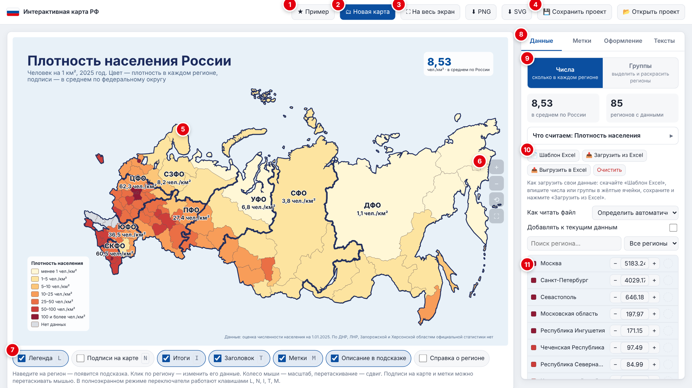

1. **«★ Пример»** — открыть готовый пример: плотность населения по регионам и федеральным округам.
2. **«🗂 Новая карта»** — начать новую карту с готовой основы (раздел 4).
3. **«На весь экран»**, **«⬇ PNG»**, **«⬇ SVG»** — показ на проекторе и сохранение картинки (разделы 15 и 16).
4. **«💾 Сохранить проект»** и **«📂 Открыть проект»** — хранить карты в файлах и передавать коллегам (раздел 16).
5. **Карта.** Наведите мышь на регион — появится подсказка. Щёлкните — откроется окошко для его данных.
6. **Кнопки масштаба:** приблизить, отдалить, показать всю карту, на весь экран.
7. **Переключатели под картой:** легенда, подписи, итоги, заголовок, метки, описание и справка в подсказке.
8. **Вкладки настроек:** «Данные», «Метки», «Оформление», «Тексты».
9. **Режим данных:** «Числа» или «Группы».
10. **Кнопки Excel:** шаблон, загрузка, выгрузка, очистка.
11. **Список всех 89 регионов** с поиском и фильтром.

---

## 4. Готовые карты и пример

Нажмите **«🗂 Новая карта»** и выберите основу. Текущая карта будет заменена — если она нужна, сначала нажмите «Сохранить проект».

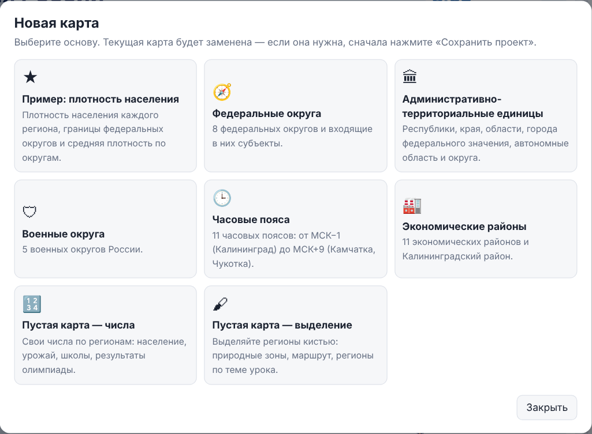

| Основа | Что внутри |
| --- | --- |
| Пример: плотность населения | Плотность населения каждого региона, границы федеральных округов, средняя плотность по округам и по России |
| Федеральные округа | 8 округов, у каждого свой цвет и подпись (ЦФО, СЗФО…) |
| Административно-территориальные единицы | Республики, края, области, города федерального значения, автономные область и округа |
| Военные округа | 5 военных округов |
| Часовые пояса | 11 поясов: от МСК−1 (Калининград) до МСК+9 (Камчатка, Чукотка) |
| Экономические районы | 11 экономических районов и Калининградский район |
| Пустая карта — числа | Чистая карта для своих чисел |
| Пустая карта — выделение | Чистая карта с двумя группами для раскраски кистью |

После выбора всё можно менять: данные, цвета, подписи, тексты, метки.

| Федеральные округа | Военные округа |
| --- | --- |
| 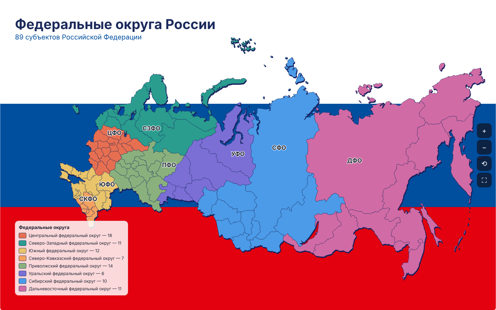 | 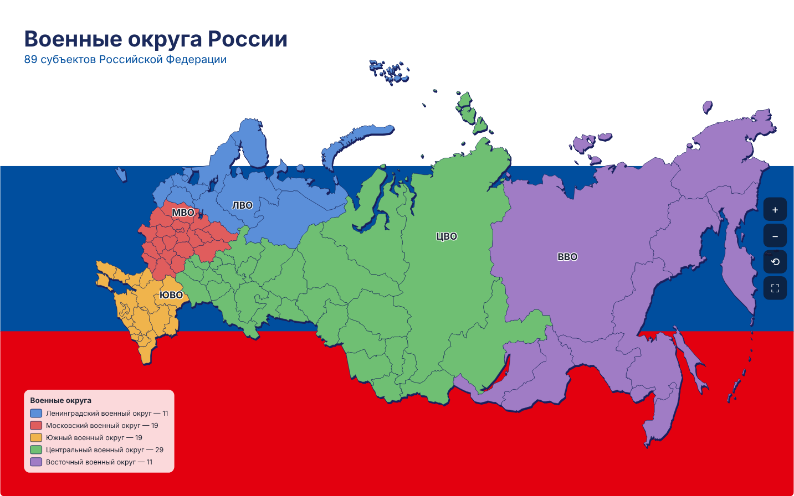 |
| **Часовые пояса** | **Экономические районы** |
| 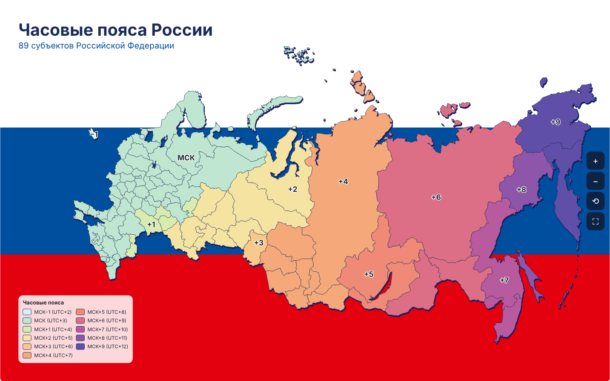 | 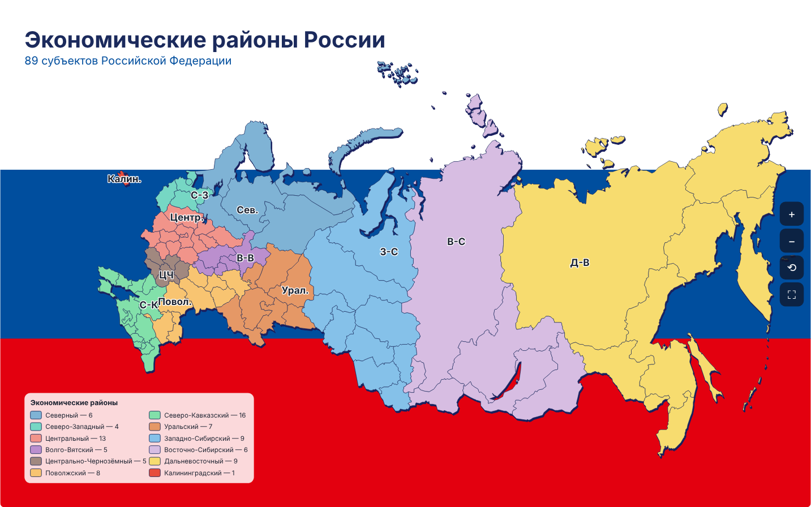 |

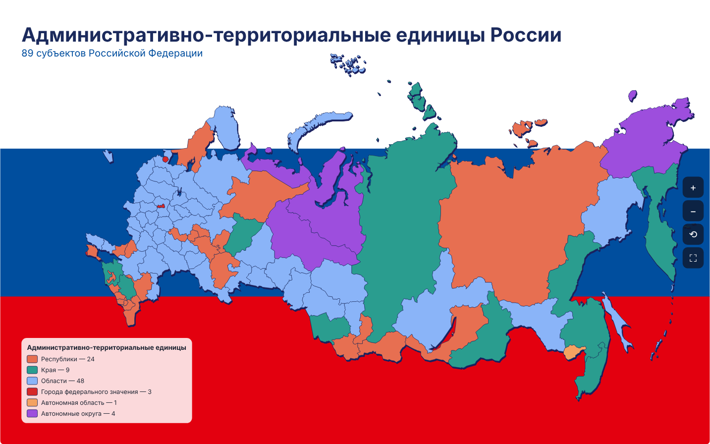

---

## 5. Режим «Числа»

Режим для случаев, когда у каждого региона есть число: население, количество школ, участников, урожай, средний балл. Включается на вкладке **«Данные»** кнопкой **«Числа»**.

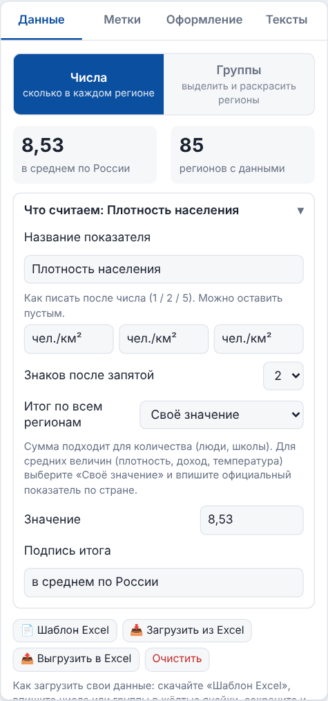

### 5.1. Что считаем

Раскройте строку **«Что считаем»**:

| Поле | Что указать |
| --- | --- |
| Название показателя | Например, «Население» или «Количество школ». Появится в подсказках и легенде |
| Как писать после числа | Три формы слова: для 1, 2 и 5 — «школа / школы / школ». Карта сама выберет нужную: «1 школа», «3 школы», «7 школ». Для единиц измерения напишите одно и то же три раза: «чел./км²». Можно оставить пустым |
| Знаков после запятой | 0 для целых чисел, 1–3 для дробных |
| Итог по всем регионам | Как считать общий итог (см. ниже) |
| Подпись итога | Текст под итогом, например «в среднем по России» |
| Показывать % от общего | Доля региона в подсказке. Доступно, только когда итог — сумма |

**Итог по всем регионам** показывается в панели «Данные» и на плашке «Итоги» на карте. Выберите подходящий:

| Итог | Когда подходит |
| --- | --- |
| Сумма | Количество: люди, школы, участники |
| Среднее по регионам | Простое среднее значений регионов |
| Медиана | Значение «посередине»: меньше зависит от очень больших и очень маленьких чисел |
| Максимум, минимум | Самое большое и самое маленькое значение |
| Своё значение | Впишите число вручную. Нужно для средних величин — плотности, дохода, температуры: их среднее по стране нельзя получить простым сложением или усреднением регионов |

> Пример: плотность населения Москвы — больше 5 000 чел./км², а Чукотки — меньше 0,1. Простое среднее по регионам даст около 144, а настоящая плотность по России — 8,53. Поэтому в примере выбрано «Своё значение».

### 5.2. Как вписать числа

- **В списке регионов.** Найдите регион поиском (например, «карел») и нажимайте **+** и **−** или впишите число в поле.
- **На карте.** Щёлкните по региону — откроется окошко с числом.

Чтобы убрать данные региона, поставьте 0 или сотрите число.

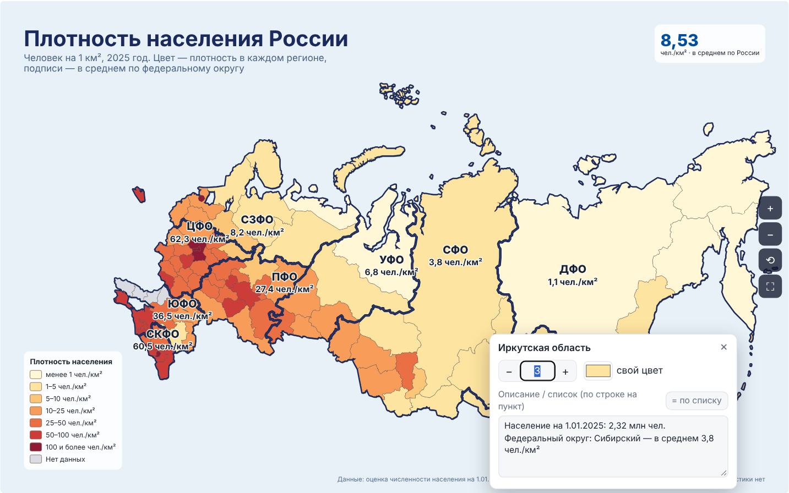

### 5.3. Описание региона

В окошке региона есть поле **«Описание / список»**. Впишите туда, что должно появляться при наведении мыши: столицу, факты, ФИО участников — по одному пункту в строке. Кнопка **«= по списку»** ставит число, равное количеству строк: удобно, когда в описании список людей.

### 5.4. Список регионов

- Поиск находит регион по части названия.
- Фильтр показывает все регионы, только с данными или только без данных.
- Наведите мышь на строку — регион подсветится на карте.
- Кружок справа задаёт региону свой цвет. Правый щелчок по кружку сбрасывает цвет.

---

## 6. Режим «Группы» и кисть

Режим для случаев, когда регионы нужно не посчитать, а выделить цветом: природные зоны, «где мы были», регионы с нефтью и газом, маршрут экспедиции. Включается на вкладке **«Данные»** кнопкой **«Группы»**.

Группа — это цвет и подпись в легенде. Каждый регион может быть в одной группе или ни в одной.

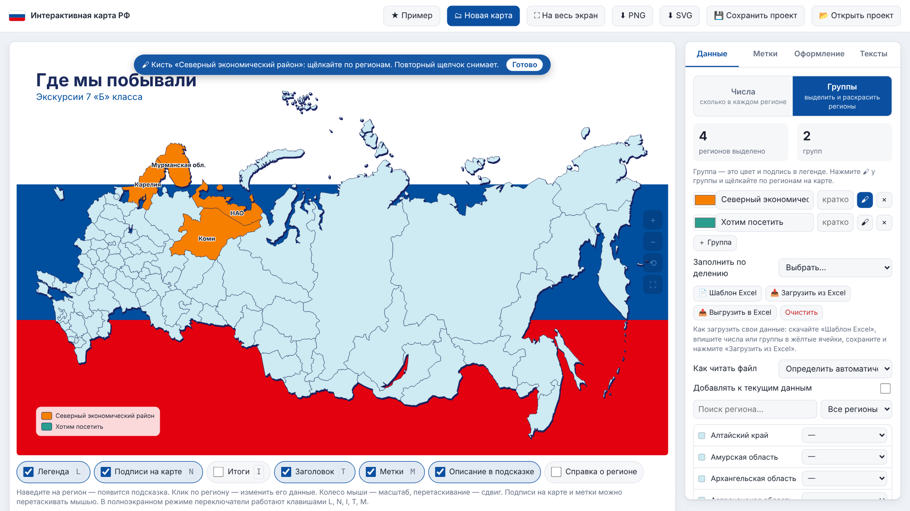

### 6.1. Как раскрасить кистью

1. Задайте у группы цвет (квадратик слева) и название для легенды.
2. В поле **«кратко»** можно написать короткую подпись для карты, например «ЦФО». Если оставить пустым, на карте будет полное название.
3. Нажмите **🖌** у нужной группы. Над картой появится синяя плашка «Кисть».
4. Щёлкайте по регионам на карте — они сразу окрашиваются. Повторный щелчок снимает выделение.
5. Нажмите **«Готово»** на плашке или клавишу **Esc**.

### 6.2. Другие способы

- **«＋ Группа»** добавляет группу, **×** удаляет её (с регионов снимется выделение).
- В **списке регионов** у каждого есть выпадающий список групп.
- **Щелчок по региону** без кисти открывает окошко с выбором группы и полем описания.
- **«Заполнить по делению»** сразу раскрашивает карту по федеральным округам, военным округам, часовым поясам, экономическим районам или видам субъектов. Дальше карту можно поправить кистью.
- Группы можно загрузить из Excel (раздел 7).

---

## 7. Загрузка и выгрузка Excel

На вкладке **«Данные»** есть три кнопки:

| Кнопка | Что делает |
| --- | --- |
| 📄 Шаблон Excel | Скачивает пустую таблицу со всеми 89 регионами и подробной инструкцией |
| 📥 Загрузить из Excel | Загружает заполненный шаблон, выгрузку или любую свою таблицу с регионами (.xlsx или .csv) |
| 📤 Выгрузить в Excel | Сохраняет данные текущей карты в такую же таблицу |

Шаблон и выгрузка устроены одинаково. Выгрузку можно отправить коллеге, он исправит числа и вернёт файл, а вы загрузите его обратно.

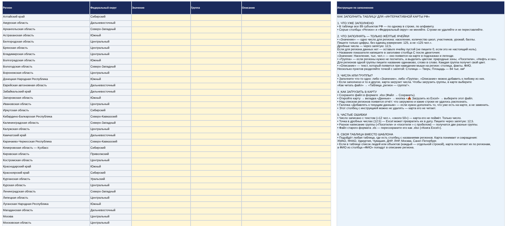

### 7.1. Как заполнить шаблон

| Столбец | Что в нём |
| --- | --- |
| Регион, Федеральный округ (серые) | Уже заполнены. Не меняйте, строки не удаляйте и не переставляйте |
| Значение (жёлтый) | Одно число для региона. Только цифры, без единиц измерения. Дробные — через запятую: 12,5. Нет данных — оставьте пустым |
| Группа (жёлтый) | Название группы, если регионы нужно выделить цветом. Для регионов одной группы пишите название одинаково, слово в слово |
| Описание (жёлтый) | Текст для подсказки при наведении. Несколько пунктов разделяйте точкой с запятой: `Столица — Тверь; Площадь — 84 тыс. км²` |
| Инструкция по заполнению | Подсказка прямо в файле. Карта этот столбец не читает, удалять его не нужно |

**Название показателя** можно указать в заголовке столбца C после двоеточия: `Значение: Население, тыс. чел.`. Карта подхватит его, и оно появится в подсказках и легенде.

**Числа или группы.** Заполните что-то одно. Если заполнено и то, и другое, загрузятся числа. Чтобы загрузить группы, выберите в поле «Как читать файл» вариант «Таблица „регион — группа“».

### 7.2. Как загрузить

1. Сохраните файл в формате **.xlsx**.
2. В карте: вкладка **«Данные»** → **«📥 Загрузить из Excel»** → выберите файл.
3. Над списком регионов появится отчёт: что загружено и какие строки не удалось распознать. Нераспознанные регионы добавьте вручную.

| Настройка | Зачем |
| --- | --- |
| Как читать файл → Определить автоматически | Обычно подходит: карта сама поймёт, что в таблице |
| Список (люди, объекты) — посчитать по регионам | В таблице каждая строка — человек или объект, а в одном из столбцов указан регион. Карта посчитает строки по регионам, а ФИО из столбца «ФИО» попадут в описание |
| Таблица «регион — число» | Каждый регион встречается один раз, рядом число |
| Таблица «регион — группа» | Каждый регион встречается один раз, рядом название группы |
| Добавлять к текущим данным | Не заменять данные на карте, а дополнить их. Например, если регистрация пришла двумя файлами |

### 7.3. Своя таблица

Подойдёт любая таблица Excel, где есть столбец с названиями регионов. Карта найдёт его сама и поймёт разные написания: «ХМАО», «Югра», «Удмуртия», «Чувашия», «ДНР», «ЛНР», «г. Москва», «Санкт-Петербург», «Кузбасс», «Якутия» и другие.

### 7.4. Частые ошибки в таблице

- **Число с текстом** («12 чел.», «около 50») — карта его не поймёт. Пишите только число.
- **Точка в дробных числах** (12.5) — Excel может превратить их в дату. Пишите через запятую: 12,5.
- **Разное написание группы** («Посетили» и «посетили » с пробелом в конце) — получатся две разные группы.
- **Старый формат .xls** — откройте файл в Excel и сохраните как «Книга Excel (.xlsx)».

---

## 8. Закраска регионов

Вкладка **«Оформление»** → раздел **«Закраска регионов»**.

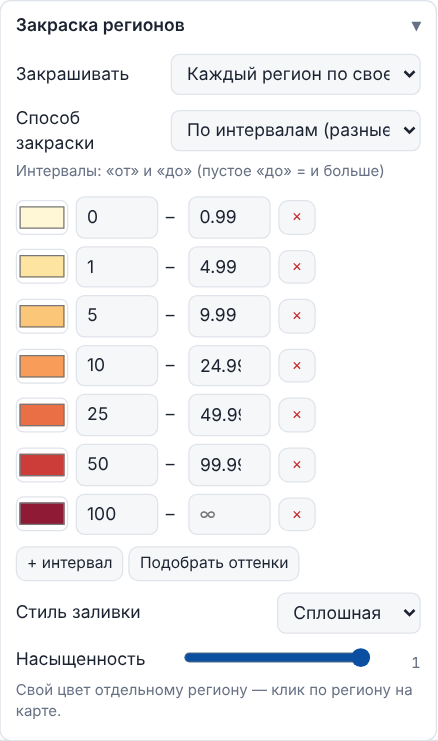

### 8.1. Каждый регион или вся группа одним цветом

Поле **«Закрашивать»** (только в режиме «Числа»):

| Вариант | Результат |
| --- | --- |
| Каждый регион по своему значению | У каждого региона свой цвет по его числу |
| Одним цветом: федеральные округа (военные округа, экономические районы, часовые пояса, виды субъектов) | Все регионы одной части окрашиваются одинаково |

Если выбрана закраска по частям, появится поле **«Цвет группы — по»**: среднему значению, медиане, максимальному значению, минимальному значению или сумме значений.

В подсказке при этом видно и собственное число региона, и значение по группе.

### 8.2. Способ закраски

| Способ | Как выглядит |
| --- | --- |
| По интервалам | Несколько цветов по диапазонам: например, 1, 2–3, 4–6, 7 и больше |
| Плавная шкала | Цвет плавно меняется от наименьшего значения к наибольшему (градиент). Задаются два цвета |
| Один цвет для всех | Все регионы с данными одного цвета |
| Каждый регион своим цветом | Разноцветная карта, палитра на выбор |

**Интервалы.** Каждая строка — цвет и диапазон «от — до». Пустое «до» означает «и больше». **«+ интервал»** добавляет строку, **×** удаляет. **«Подобрать оттенки»** раскрашивает интервалы плавно от светлого к тёмному.

**Стиль заливки:** сплошная, штриховка, точки или сетка. Штриховка удобна для печати на чёрно-белом принтере.

**Насыщенность** делает заливку бледнее.

**Свой цвет отдельному региону** — щелчок по региону на карте → «свой цвет». Сбросить можно там же.

В режиме «Группы» цвета задаются у самих групп (вкладка «Данные»), а здесь меняются только стиль заливки и насыщенность.

---

## 9. Границы делений поверх карты

Вкладка **«Оформление»** → **«Границы делений поверх карты»**. Обводит жирной линией федеральные округа, военные округа, экономические районы, часовые пояса или виды субъектов поверх любой раскраски. Например, плотность населения по регионам и границы федеральных округов.

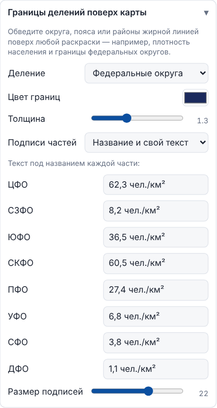

| Настройка | Что делает |
| --- | --- |
| Деление | Какие границы рисовать. «Нет» — без границ |
| Цвет границ, толщина | Вид линии |
| Подписи частей | Название; название и свой текст; название и среднее, медиана, максимум, минимум или сумма по регионам; без подписей |
| Размер подписей | Размер текста |

**«Название и свой текст»** позволяет вписать под названием каждой части любой текст: настоящую плотность округа, столицу, число. Поля для текста появятся ниже.

> Средние величины (плотность, доход) нельзя честно посчитать простым средним по регионам. Для них используйте «свой текст» с официальным значением, как в примере.

Подписи частей можно перетаскивать мышью.

---

## 10. Подписи на регионах

Вкладка **«Оформление»** → **«Подписи на регионах»**.

| Что подписывать | Как выглядит |
| --- | --- |
| Число (режим «Числа») | Кружок с числом на каждом регионе с данными |
| Название группы (режим «Группы») | Название (или краткая подпись) группы — один раз на самом большом её регионе |
| Название региона | Короткое название: «Тверская обл.», «Удмуртия», «ХМАО — Югра». Можно показать только у регионов с данными или у всех 89 |
| Без подписей | Ничего |

Настраиваются размер, цвет текста и обводки, цвет кружка.

**Если подписи налезают друг на друга**, перетащите их мышью: нажмите на подпись и, не отпуская кнопку, передвиньте. К региону потянется линия-выноска. Кнопка **«Вернуть подписи на места»** возвращает всё как было. В центре европейской части регионы мелкие, поэтому при подписях всех 89 регионов там будет тесно — уменьшите размер или приблизьте карту.

---

## 11. Метки

Метка — точка с подписью: город, месторождение, заповедник, место проведения мероприятия. Вкладка **«Метки»**.

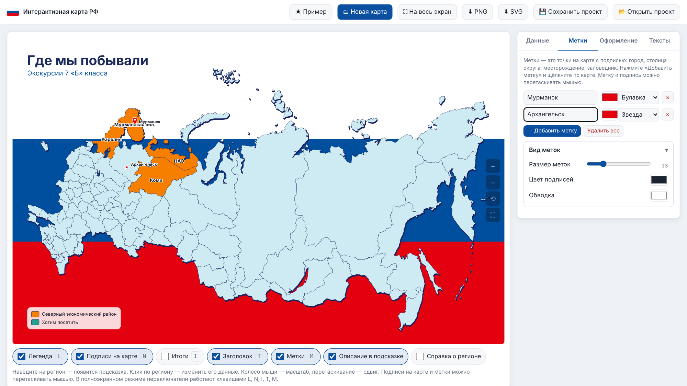

1. Нажмите **«＋ Добавить метку»** — над картой появится подсказка.
2. Щёлкните по карте в нужном месте.
3. Сразу напечатайте подпись — она вводится в списке меток.
4. Выберите цвет и форму: булавка, кружок, звезда, квадрат или флажок.

Метку и её подпись можно перетаскивать мышью по отдельности. Если отодвинуть подпись подальше, к метке потянется линия. **×** удаляет метку, **«Удалить все»** — все метки сразу.

В разделе **«Вид меток»** настраиваются размер всех меток, цвет подписей и цвет обводки.

> Метки ставятся щелчком по карте, а не по координатам. Положение города задайте на глаз — для урока и презентации этого достаточно.

---

## 12. Легенда и итоги

Вкладка **«Оформление»** → **«Легенда и итоги»**.

**Легенда** — плашка с объяснением цветов.

- Заголовок, угол карты, размер текста, цвет и прозрачность подложки.
- Пункт для регионов без данных и его подпись (например, «Нет участников»).
- В режиме «Группы» — число регионов рядом с каждой группой.
- Если пунктов больше восьми, легенда сама разбивается на две колонки.

**Итоги** — плашка с общим итогом (раздел 5.1) и числом регионов с данными. Число регионов можно скрыть. Настраиваются угол, размер, цвета.

**Перемещение и размер плашек.** Легенду, итоги, заголовок и подпись внизу можно двигать прямо на карте, если они закрывают регионы:

- **Переместить** — нажмите на плашку и, не отпуская кнопку мыши, перетащите в нужное место.
- **Изменить размер** — наведите мышь на плашку: появится пунктирная рамка и синий уголок справа снизу. Тяните уголок вправо, чтобы увеличить, или влево, чтобы уменьшить.
- **Вернуть как было** — кнопка «Вернуть плашки на места» в разделе «Легенда и итоги».

Рамка и уголок видны только при наведении и на скачанную картинку не попадают.

---

## 13. Оформление

Вкладка **«Оформление»**.

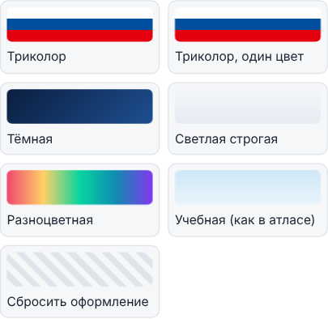

**Готовые темы** меняют только цвета — данные, метки и тексты остаются. Темы: «Триколор», «Триколор, один цвет», «Тёмная», «Светлая строгая», «Разноцветная», «Учебная (как в атласе)». **«Сбросить оформление»** возвращает исходный вид.

| Раздел | Что можно поменять |
| --- | --- |
| Карта | Цвет регионов без данных, цвет и толщина границ, объём (тень-подложка под картой), мягкая тень, цвет подсветки при наведении, размер карты, сдвиг влево-вправо и вверх-вниз |
| Фон за картой | Триколор (насыщенные или официальные цвета флага), один цвет, градиент с углом, своя картинка, прозрачный. «Приглушить фон» делает его бледнее |
| Формат и страница | Форма картинки: 16:9 и 16:10 — для экрана и презентации, 3:2, 4:3, A4 (альбом) — для печати, 1:1 — для соцсетей. Цвет фона вокруг карты в полноэкранном режиме |

---

## 14. Тексты

Вкладка **«Тексты»**.

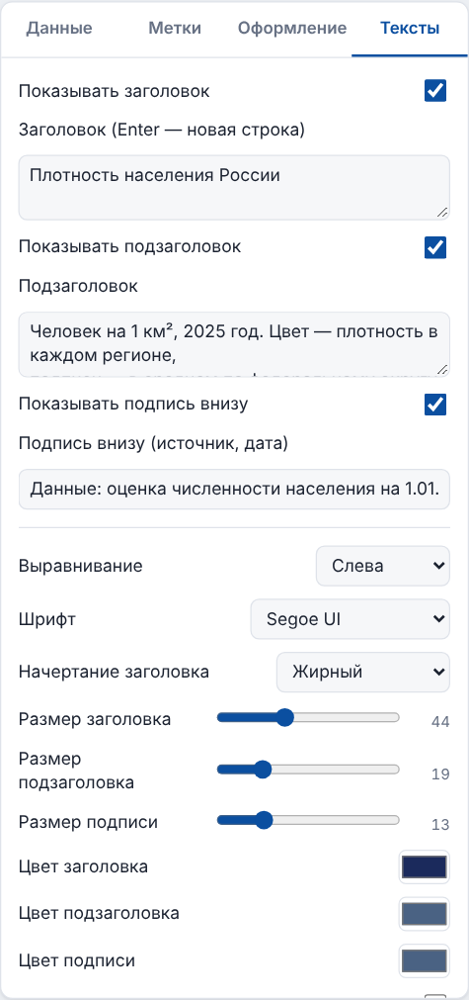

| Поле | Пример |
| --- | --- |
| Заголовок | «Плотность населения России». Enter — перенос на новую строку |
| Подзаголовок | «Человек на 1 км², 2025 год» |
| Подпись внизу | Источник данных или дата: «Данные Росстата на 01.01.2025» |

Каждую надпись можно скрыть. Настраиваются выравнивание, шрифт, начертание, размеры и цвета. **«Подложка под заголовком»** помогает, если заголовок плохо читается на фоне.

---

## 15. Показ на экране и горячие клавиши

**Полный экран** — кнопка «На весь экран» или клавиша **F**. Выйти — **Esc** или снова **F**.

| Действие | Как сделать |
| --- | --- |
| Приблизить или отдалить | Колёсико мыши или кнопки + и − на правом краю карты |
| Сдвинуть приближенную карту | Зажать левую кнопку мыши и тянуть |
| Показать всю карту | Кнопка ⟲ |
| Узнать данные региона | Навести мышь — появится подсказка |
| Передвинуть легенду, итоги, заголовок | Перетащить мышью; размер — за уголок справа снизу |

| Клавиша | Что делает |
| --- | --- |
| F | Полный экран / выход |
| L | Показать или скрыть легенду |
| N | Показать или скрыть подписи на карте |
| I | Показать или скрыть итоги |
| T | Показать или скрыть заголовок |
| M | Показать или скрыть метки |
| Esc | Закрыть окошко, выйти из режима кисти или постановки метки, выйти из полноэкранного режима |

Клавиши работают в любой раскладке.

**Подсказка при наведении** показывает значение региона и его описание. Переключатель **«Справка о регионе»** добавляет к ней федеральный округ, военный округ, экономический район и часовой пояс — удобно на уроке. Переключатель **«Описание в подсказке»** скрывает описания, например ФИО, когда карту показывают на большом экране.

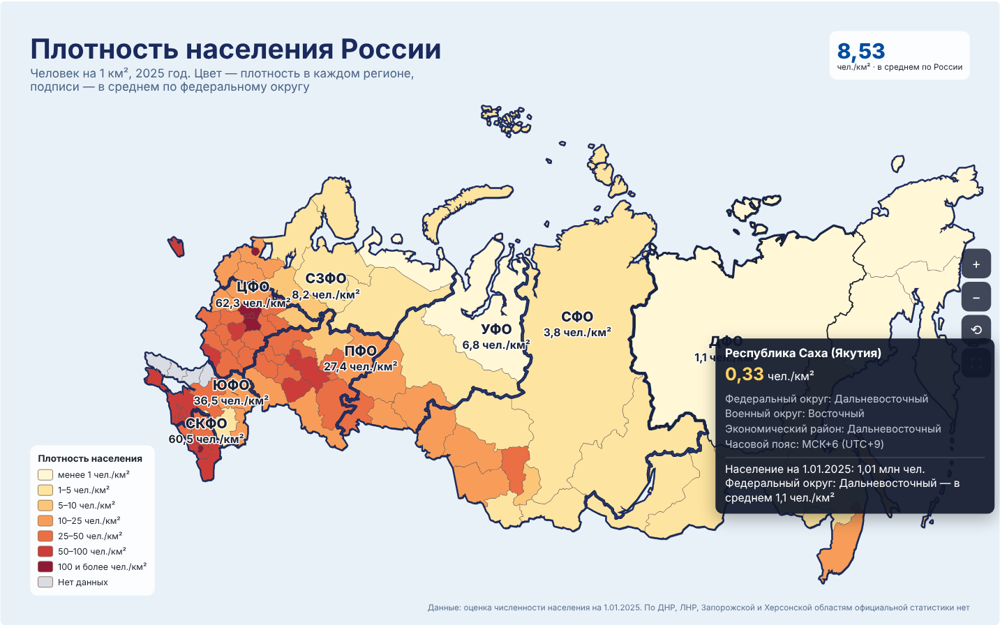

---

## 16. Сохранение и передача

### Картинка

| Кнопка | Что получится |
| --- | --- |
| ⬇ PNG | Картинка в высоком качестве — для презентации, Word, письма, мессенджера |
| ⬇ SVG | Векторная картинка — для дизайнера или типографии, увеличивается до размера плаката без потери качества |

На картинку попадает вся карта целиком и только то, что сейчас включено. Кнопки масштаба и подсказки на неё не попадают.

### Проект

Браузер помнит только последнюю карту и только на вашем компьютере. Чтобы хранить несколько карт (по одной на урок или мероприятие) и передавать их, сохраняйте проект в файл.

1. **«💾 Сохранить проект»** — скачается файл `.json` с названием как у заголовка карты. В нём всё: данные, цвета, метки, тексты.
2. **«📂 Открыть проект»** — выберите файл `.json`, и карта станет такой, какой была при сохранении.

### Передать коллеге

| Что нужно коллеге | Что отправить |
| --- | --- |
| Посмотреть картинку | PNG |
| Проверить или дополнить данные | Выгрузку в Excel (раздел 7) |
| Работать с картой дальше | `Интерактивная карта РФ.html` и файл проекта `.json` |

> Некоторые почтовые сервисы не пропускают файлы `.html`. Запакуйте его в ZIP-архив или отправьте через мессенджер или облако.

---

## 17. Готовые сценарии для урока

### Федеральные округа

1. «🗂 Новая карта» → «Федеральные округа».
2. Включите «Справка о регионе», чтобы при наведении был виден округ, часовой пояс и экономический район.
3. Вкладка «Метки» — поставьте звёздочки на столицах округов.
4. «На весь экран» — и карта готова к показу.

### Карта по своим данным (например, число школ)

1. «🗂 Новая карта» → «Пустая карта — числа».
2. «Данные» → «📄 Шаблон Excel». Впишите числа в столбец «Значение», в заголовке напишите `Значение: Количество школ`.
3. «📥 Загрузить из Excel».
4. «Что считаем» → формы слова «школа / школы / школ», итог — «Сумма».
5. «Оформление» → «Закраска» → «Плавная шкала».
6. «Тексты» — заголовок и источник данных.

### «Где мы побывали»

1. «🗂 Новая карта» → «Пустая карта — выделение».
2. Переименуйте группы: «Побывали», «Планируем».
3. Кисть 🖌 — раскрасьте регионы на карте.
4. Метки — города поездок.
5. «⬇ PNG» — картинка для стенгазеты или сайта школы.

### Сравнение: плотность населения и федеральные округа

1. «★ Пример».
2. «Оформление» → «Закрашивать» → «Одним цветом: федеральные округа» → «по среднему значению». Сравните с раскраской «каждый регион по своему значению».
3. Обсудите с классом, почему среднее по регионам не равно настоящей плотности округа.

### Участники мероприятия

1. «🗂 Новая карта» → «Пустая карта — числа».
2. «📥 Загрузить из Excel» → выберите таблицу регистрации, где каждый участник в отдельной строке. Карта посчитает участников по регионам, ФИО попадут в подсказки.
3. «Что считаем» → «участник / участника / участников», итог — «Сумма».
4. Вкладка «Метки» — место проведения.

---

## 18. Частые вопросы и проблемы

| Проблема | Что сделать |
| --- | --- |
| Файл открылся как текст с непонятными символами | Правый щелчок по файлу → «Открыть с помощью» → браузер |
| Карта открылась «чистой», без моих изменений | Вы открыли файл в другом браузере или на другом компьютере. Нажмите «Открыть проект» и выберите свой `.json` |
| Запутался в цветах | «Оформление» → «Готовые темы» → «Сбросить оформление» |
| Случайно изменил данные | Откройте сохранённый проект или заново загрузите Excel |
| После загрузки Excel написано «Не распознано» | В таблице регион записан необычно или с опечаткой. Добавьте его вручную в списке регионов |
| Excel не загружается | Проверьте, что файл в формате `.xlsx`. Старый `.xls` пересохраните в Excel |
| Загрузились числа, а нужны были группы | «Как читать файл» → «Таблица „регион — группа“» и загрузите снова |
| Итог на плашке бессмысленный (например, сумма плотностей) | «Что считаем» → «Итог по всем регионам» → «Своё значение» или «Среднее» |
| Подписи налезают друг на друга | Перетащите их мышью или уменьшите размер. Можно приблизить карту колёсиком |
| Легенда или итоги закрывают часть карты | Перетащите плашку мышью в свободное место или уменьшите её за уголок справа снизу (раздел 12) |
| Карта слишком приближена или сдвинута | Кнопка ⟲ на правом краю карты |
| Не получается выйти из полного экрана | Клавиша Esc |
| Письмо с файлом не дошло | Запакуйте `.html` в ZIP или отправьте через мессенджер |

---

## 19. Справочные данные и источники

- **Субъекты РФ.** 89 субъектов, включая Республику Крым, Севастополь, ДНР, ЛНР, Запорожскую и Херсонскую области.
- **Федеральные округа:** ЦФО — 18 субъектов, СЗФО — 11, ЮФО — 12, СКФО — 7, ПФО — 14, УФО — 6, СФО — 10, ДФО — 11. ДНР, ЛНР, Запорожская и Херсонская области отнесены к Южному федеральному округу, как на большинстве учебных карт. Если по программе нужен другой вариант, поправьте регионы кистью.
- **Военные округа:** Ленинградский, Московский, Южный, Центральный, Восточный.
- **Часовые пояса:** от МСК−1 до МСК+9. В Якутии три пояса (МСК+6, +7, +8); на карте она закрашена по Якутску — МСК+6, это указано в подсказке.
- **Экономические районы:** Северный, Северо-Западный, Центральный, Волго-Вятский, Центрально-Чернозёмный, Поволжский, Северо-Кавказский, Уральский, Западно-Сибирский, Восточно-Сибирский, Дальневосточный и Калининградский. Крым, Севастополь и новые регионы отнесены к Северо-Кавказскому району.
- **Плотность населения в примере:**
  - плотность регионов — [TerraVisor](https://terravisor.com/data/regions/density), 2025 год;
  - численность населения на 1 января 2025 года — оценка Росстата по данным [«Мой город»](https://www.mojgorod.ru/regs/pop2025_1.html); Архангельская и Тюменская области указаны без входящих в них автономных округов;
  - средняя плотность по федеральным округам рассчитана по численности и площади округов ([geo-ref.net](https://geo-ref.net/ph/rus.htm));
  - по ДНР, ЛНР, Запорожской и Херсонской областям официальной статистики нет — на карте они отмечены как «Нет данных».

Перед использованием данных на уроке или в официальном документе сверьте их с актуальными данными Росстата.

---

## 20. Для разработчиков

- **Один файл.** Разметка, стили, скрипт и данные встроены в `Интерактивная карта РФ.html`. Внешних библиотек и сборки нет, интернет не нужен.
- **Карта** — SVG-контуры 89 субъектов, построенные на основе `russia-map.svg`.
- **Чтение и запись Excel** реализованы внутри файла: `.xlsx` распаковывается встроенным `DecompressionStream`, при выгрузке ZIP собирается без сжатия.
- **Состояние** хранится в `localStorage` браузера (ключ `rfMap.v1`). Проект сохраняется и открывается как JSON того же формата.
- **Поддержка браузеров:** актуальные Chrome, Edge, Яндекс Браузер, Firefox, Safari.
- **Публикация на GitHub Pages:** переименуйте файл в `index.html` или добавьте ссылку на него из `index.html`.

### Состав репозитория

| Файл | Назначение |
| --- | --- |
| `Интерактивная карта РФ.html` | Программа |
| `Шаблон для карты РФ.xlsx` | Шаблон Excel для заполнения |
| `README.md` | Эта инструкция |
| `Инструкция — Интерактивная карта РФ.docx` | Эта же инструкция в формате Word |
| `docs/images/` | Скриншоты для инструкции |
